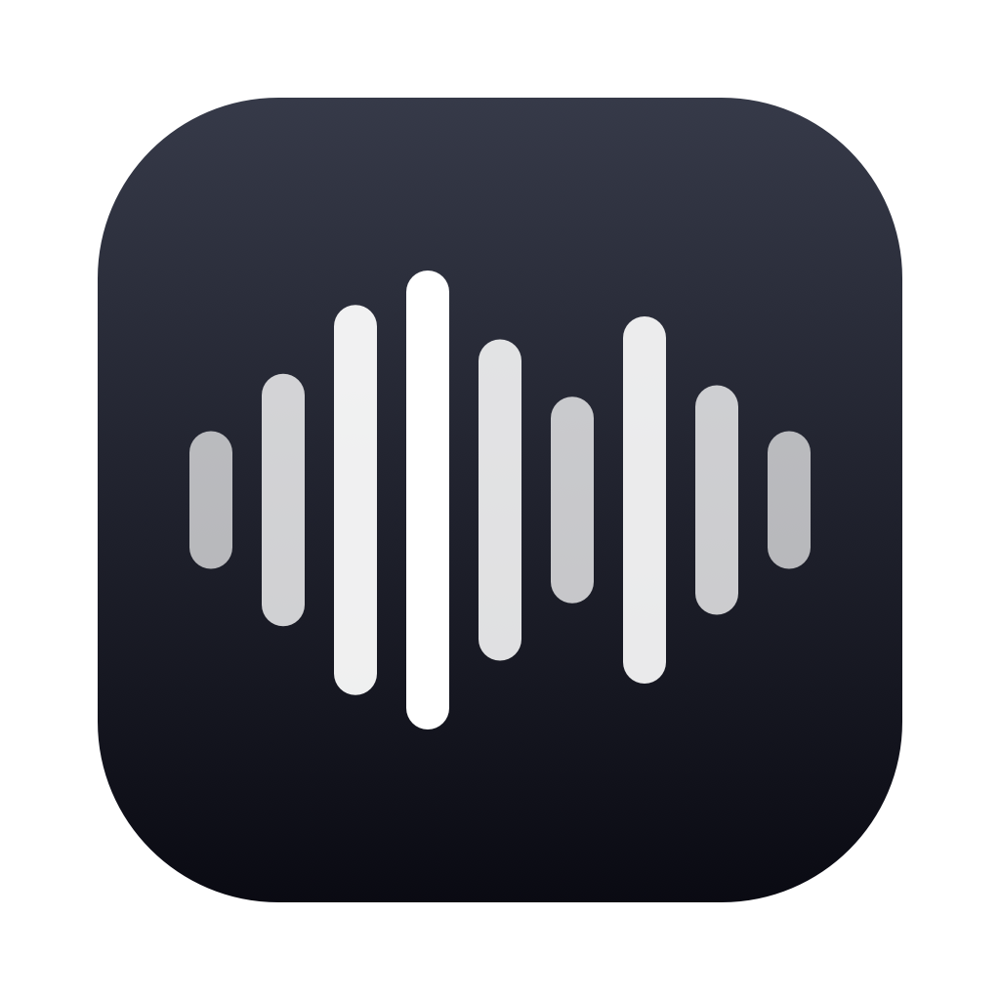

<h1 align="center">VoiceNoah</h1>

<b>Stop typing. Start talking.</b> 
Your voice is the fastest keyboard you own. Speak naturally in any of 90+ languages, or mix them in the same sentence, and VoiceNoah turns it into clean, ready-to-send text in any app on your computer.

  <a href="https://github.com/mustafamahermm/VoiceNoah/releases/latest"><b>⬇️ Download for Mac (.dmg)</b></a> &nbsp;·&nbsp;
  <a href="https://github.com/mustafamahermm/VoiceNoah/releases/latest"><b>⬇️ Download for Windows (.exe)</b></a>

---

## Why VoiceNoah

Typing is the bottleneck between your ideas and the screen. Most people type around **40 words a minute**, but speak at **130 to 150**.
VoiceNoah makes voice your main way to write: emails, messages, documents, notes, code comments, and prompts for ChatGPT and Claude. You talk, it writes, about **3× faster than typing**.

It is also built for the way people really talk. Many of us switch languages mid-sentence, and most dictation tools fall apart there:
*"عايز أعمل meeting بكرة عشان نراجع الـ deadline"* comes out with the English words in Arabic letters, or "corrected" into formal Arabic, or simply wrong.
VoiceNoah keeps every word in the language you said it in, and keeps your dialect: Egyptian Arabic stays Egyptian, English stays English, French stays French.

## What it does

- **Works in every app.** Notion, Gmail, Slack, WhatsApp, Word, Google Docs, ChatGPT, Claude, Cursor. If it has a text box, VoiceNoah can write in it. No plugins, no copy-paste.
- **90+ languages, mixed freely.** Arabic, English, French, Spanish, German, Turkish, Hindi, Urdu and many more, detected automatically. Mix two languages in one sentence and it keeps both.
- **Types while you talk.** Your words stream live, and each sentence lands in the text box as soon as you pause. When you let go, the last words appear in about half a second.
- **Writes the way you meant it.** Filler sounds ("umm", "آآ", "euh") are removed. With the optional AI polish, punctuation is fixed and self-corrections are applied: *"at 3… no, I mean 4"* becomes *"at 4"*. It never translates you.
- **Learns your words.** Add names, brands and jargon to your personal dictionary so they're always spelled right, and set automatic replacements.
- **Your shortcut, your way.** Hold fn, or record any key or combination, so it works with any keyboard, including external ones.
- **See the time you get back.** A dashboard with words per day, your speaking speed, time spent speaking, time saved compared with typing, your streak, and a searchable history.
- **Stays out of the way.** A small black pill appears just above the Dock only while you speak.
- **No subscription to VoiceNoah.** You use your own speech-engine key and pay only for what you use. The free plan covers about 2.5 hours of dictation a month.
- **Private by design.** Your history and keys stay on your computer. Audio is sent to the speech engine only while you hold the shortcut.

## How it works

| | Mac | Windows |
|---|---|---|
| Talk | Hold **fn** and speak | Hold **Right Ctrl** and speak |
| Let go | Your words are typed where your cursor is | Same |
| Long dictation | Tap the shortcut once for hands-free, tap again to finish | Same |
| Cancel | **Esc** | **Esc** |

You can change the shortcut in **Settings**.

## Get started (2 minutes)

### 1. Install

**Mac** (Apple Silicon, M1 or newer)
1. Download `VoiceNoah-…-mac.dmg` from the [latest release](https://github.com/mustafamahermm/VoiceNoah/releases/latest) and open it.
2. Drag **VoiceNoah** into **Applications**.
3. The first time only: in Applications, **right-click VoiceNoah → Open → Open**. macOS asks this because the app is free and not from the App Store. If it still refuses, go to System Settings → Privacy & Security → **Open Anyway**.
4. Allow **Accessibility** and **Microphone** for VoiceNoah when macOS asks.
5. System Settings → Keyboard → **"Press 🌐 key to"** → **Do Nothing**, so `fn` doesn't open the emoji picker.

**Windows** (10 or 11)
1. Download `VoiceNoah-…-windows.exe` from the [latest release](https://github.com/mustafamahermm/VoiceNoah/releases/latest) and double-click it.
2. If Windows SmartScreen appears: **More info → Run anyway** (the app is free and not signed by Microsoft).
3. VoiceNoah appears in the system tray (bottom-right, near the clock).

> The Windows version is brand new. If something does not work, please [open an issue](https://github.com/mustafamahermm/VoiceNoah/issues).

### 2. Connect the speech engine (free)

1. Create a free account on [ElevenLabs](https://elevenlabs.io/app/sign-up).
2. Open **Developers → [API keys](https://elevenlabs.io/app/developers/api-keys)** → **Create Key**.
3. Name it `VoiceNoah`, set **Speech to Text → Access**, leave everything else on **No Access**, and click **Create Key**.
4. **Copy the key right away** (it starts with `sk_` and is shown only once).
5. In the VoiceNoah window: **Settings → paste the key → Save & test**. You'll see ✓ Works.

That's it. Put your cursor in any text box, hold the shortcut and talk.

### Optional: AI polish with Claude

For perfectly punctuated, edited text, add an Anthropic API key: [platform.claude.com](https://platform.claude.com) → Settings → API keys → Create key → paste it in **Settings → Text polish**, then turn on **Polish with Claude**.

## Pricing, honestly

VoiceNoah itself is free and open source. The speech engine is ElevenLabs:

| ElevenLabs plan | Live dictation per month (approx.) |
|---|---|
| Free | ~2.5 hours |
| Starter, $6/month | ~27 hours |
| Creator, $22/month | ~100 hours |

When the monthly credit runs out, dictation stops until it renews or you upgrade on ElevenLabs.

## Privacy

- Your keys, settings, history and the last 20 recordings are stored only on your computer
  (Mac: `~/Library/Application Support/VoiceNoah`, Windows: `%APPDATA%\VoiceNoah`).
- Audio goes to ElevenLabs only while you hold the shortcut. Text goes to Anthropic only if you turn on AI polish.
- No accounts, no tracking, no analytics.

## Troubleshooting

| Problem | Fix |
|---|---|
| Mac: `fn` does nothing | Turn on VoiceNoah under Privacy & Security → Accessibility, and set "Press 🌐 key to" = Do Nothing |
| Nothing gets typed | Allow the Microphone for VoiceNoah; check the ElevenLabs key in Settings |
| Mac: "can't be opened" | Right-click the app → Open, or Privacy & Security → Open Anyway |
| Windows: SmartScreen warning | More info → Run anyway |

## For developers

- `voicenoah.py`: the macOS app (PyObjC): global shortcut, recording, the pill, menu bar, window (WebKit) and typing.
- `voicenoah_win.py`: the Windows app (keyboard hook, tkinter pill, tray icon, pywebview window).
- `core.py`: shared settings, keys, speech engines, cleanup and stats. `live.py`: ElevenLabs Scribe realtime (WebSocket).
- `dashboard.html`: the app window (Home, History, Dictionary, Settings), shared by both platforms.
- Build the Mac DMG: `packaging/build_mac.sh`. The Windows EXE is built by GitHub Actions (`.github/workflows/build-windows.yml`) on every release.
- Run from source on a Mac: double-click `Install from source.command`.

---

## بالعربي

**VoiceNoah** بيخليك تبطّل كتابة وتبدأ تتكلم. صوتك أسرع كيبورد عندك: اتكلم بأي لغة من أكتر من 90 لغة، أو اخلط لغتين في نفس الجملة زي مصري وإنجليزي، والكلام يتكتب نضيف في أي برنامج على جهازك، وأسرع من الكتابة بـ 3 مرات.

1. نزّل النسخة المناسبة لجهازك من [آخر إصدار](https://github.com/mustafamahermm/VoiceNoah/releases/latest): **Mac (.dmg)** أو **Windows (.exe)**.
2. اعمل حساب مجاني على ElevenLabs، ومن **Developers ← API keys ← Create Key** خلي **Speech to Text = Access** بس، وانسخ المفتاح.
3. افتح VoiceNoah ← **Settings** ← الصق المفتاح ← **Save & test**.
4. امسك **fn** على الماك، أو **Right Ctrl** على الويندوز، واتكلم.

---

Made by [Mustafa Maher](https://github.com/mustafamahermm) · MIT License
